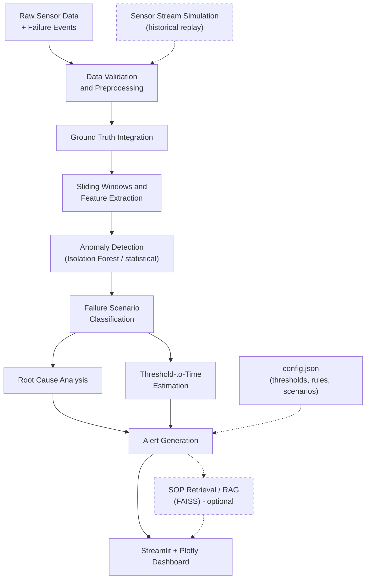

# Sentinel — Automated Diagnostics & Root Cause Analysis Platform

> An industrial predictive-maintenance and diagnostics prototype that turns time-series sensor data into anomaly alerts, failure-scenario insights, threshold-to-time estimates, and SOP-based maintenance guidance.

**Domain:** AI / Machine Learning · Industrial IoT · Predictive Maintenance
**Primary Dataset:** MetroPT-3 Air Compressor Dataset
**Project Type:** Computer Science Graduation Project (5-member team)
**Interface:** Streamlit + Plotly · **Language:** Python

> **Documentation status:** This README is a professional draft. Items marked `[TODO: ...]` are missing information, and items marked **Planned** or **To Be Confirmed** must be checked against the actual repository before release. No model results, dataset statistics, or file paths in this document are measured or verified.

---

## Table of Contents

1. [Project Overview](#1-project-overview)
2. [Main Objectives](#2-main-objectives)
3. [Core Features](#3-core-features)
4. [System Architecture](#4-system-architecture)
5. [Technology Stack](#5-technology-stack)
6. [Dataset and Ground Truth](#6-dataset-and-ground-truth)
7. [Project Structure](#7-project-structure)
8. [Installation and Setup](#8-installation-and-setup)
9. [Usage Guide](#9-usage-guide)
10. [Model Evaluation](#10-model-evaluation)
11. [Limitations and Responsible Use](#11-limitations-and-responsible-use)
12. [Team Contributions](#12-team-contributions)
13. [Roadmap](#13-roadmap)
14. [Screenshots and Demo](#14-screenshots-and-demo)
15. [Acknowledgments and Citations](#15-acknowledgments-and-citations)
16. [License](#16-license)

---

## 1. Project Overview

Industrial equipment such as air compressors generates continuous streams of sensor data (pressures, temperatures, motor current, valve states, and similar signals). Unexpected failures cause downtime, cost, and safety risk. **Sentinel** analyzes this data to:

- flag abnormal behavior,
- relate it to predefined failure scenarios,
- point to the sensors that most plausibly contribute to the problem,
- estimate how long a monitored variable may take to reach a defined critical threshold,
- assign an alert level, and
- surface relevant maintenance procedures from an approved SOP knowledge base.

Everything is presented in an interactive Streamlit dashboard. Sentinel is a **decision-support prototype**; it supports, and does not replace, expert engineering judgment or safety systems.

### Key Concepts at a Glance

| Concept | Question it answers | Output |
|---|---|---|
| **Anomaly detection** | *Is the current behavior unusual compared with normal operation?* | Anomaly score / flag per window |
| **Failure classification** | *Which predefined failure scenario does this window resemble?* | Scenario label (+ confidence, if available) |
| **Root cause analysis** | *Which sensors and features contribute most to this result?* | Ranked contributing sensors (evidence-based hypotheses) |
| **Threshold-to-Time (RUL) estimation** | *At the current trend, how long until a variable crosses a critical threshold?* | Estimated time with stated assumptions and uncertainty |

These are distinct tasks. An anomaly is not automatically a failure, a classified scenario is not a confirmed diagnosis, and a threshold-to-time estimate is not a guaranteed remaining useful life.

---

## 2. Main Objectives

- Detect abnormal patterns in industrial time-series sensor data.
- Identify and classify predefined failure scenarios.
- Analyze potential root causes using sensor behavior and model outputs.
- Estimate the remaining time before a monitored variable reaches a defined critical threshold (Threshold-to-Time RUL estimation).
- Assign alert levels based on configurable rules and diagnostic evidence.
- Retrieve relevant maintenance procedures from Standard Operating Procedures (SOPs).
- Provide an interactive dashboard for monitoring, visualization, and diagnostic reporting.
- Support simulated sensor-stream replay to demonstrate near-real-time monitoring.

---

## 3. Core Features

> Status legend: **Implemented** · **Planned** · **To Be Confirmed**. `[TODO: update each status from the actual codebase.]`

### 3.1 Data Ingestion and Preprocessing — *To Be Confirmed*
- Load CSV sensor data and JSON configuration files.
- Timestamp normalization and synchronization.
- Missing-value handling and data validation.
- Integration of sensor readings with failure-event information and ground-truth labels, when available.

### 3.2 Time-Series Analysis — *To Be Confirmed*
- Sliding-window processing.
- Window-based feature extraction (e.g., rolling statistics) `[TODO: list actual features]`.
- Sensor trend analysis and visualization.

### 3.3 Anomaly Detection — *To Be Confirmed*
- **Isolation Forest** as the baseline unsupervised anomaly-detection model.
- **Statistical methods** (Z-score, IQR, MAD) as complementary or comparison techniques where appropriate. `[TODO: confirm which are implemented.]`
  - *Z-score:* flags values far from the mean in standard deviations; sensitive to outliers and assumes roughly normal behavior.
  - *IQR:* flags values outside the interquartile fences; robust to moderate outliers.
  - *MAD:* uses the median absolute deviation; robust for skewed or heavy-tailed signals.

### 3.4 Failure Scenario Classification — *To Be Confirmed*
- Analyze time windows and classify them into predefined failure scenarios.
- Scenario labels are configurable. `[TODO: list the documented scenario labels, e.g., from config.json or project documentation.]`

### 3.5 Root Cause Analysis — *To Be Confirmed*
- Use sensor deviations from normal behavior, feature importance, and SHAP explanations (where implemented) to identify potential contributing sensors.
- Results are **evidence-based hypotheses**. Correlation and feature importance are not proof of causation.

### 3.6 RUL / Threshold-to-Time Estimation — *To Be Confirmed*
- Estimate time to a defined operational threshold using observed trends and degradation slopes.
- **Assumptions:** a reasonably stable trend, a valid threshold definition, and good data quality.
- **Limitations:** the estimate degrades with noisy or non-monotonic signals, regime changes, and sparse failure data. Reliable remaining-useful-life prediction requires sufficient failure and degradation history, which may not be available.

### 3.7 Alert Management — *To Be Confirmed*
- Configurable alert levels, thresholds, and rules `[TODO: document level names and rule format]`.
- Model outputs (anomaly score, scenario, threshold-to-time estimate) are mapped to alert levels by rule, together with supporting evidence shown to the operator.

### 3.8 SOP Retrieval and Maintenance Recommendations — *Planned / To Be Confirmed*
- FAISS-based similarity search over an approved SOP knowledge base, optionally within a RAG-style architecture `[TODO: confirm embedding model and whether an LLM is used for generation]`.
- Retrieved procedures are **recommendations from documents**, not verified diagnostic conclusions, and must be reviewed by qualified personnel.

### 3.9 Interactive Dashboard — *To Be Confirmed*
- Streamlit interface with Plotly charts.
- Depending on the final implementation: sensor trends, anomaly markers, diagnostic results, alert status, and maintenance recommendations.

### 3.10 Sensor Stream Simulation — *To Be Confirmed*
- Replays historical sensor readings in timestamp order to demonstrate near-real-time monitoring.
- **Note:** this is a simulation over recorded data and is not a live connection to industrial sensors, PLCs, or SCADA systems.

---

## 4. System Architecture

Dashed nodes and edges represent optional or planned modules whose implementation status is unconfirmed.



### Data Flow and Module Responsibilities

| Module | Responsibility |
|---|---|
| **Data validation and preprocessing** | Load CSV/JSON, normalize timestamps, handle missing values, validate schema and ranges. |
| **Ground-truth integration** | Align failure-event records with sensor timestamps to create labels for evaluation (and supervised training where applicable). |
| **Windowing and features** | Segment the stream into sliding windows and compute window-level features. |
| **Anomaly detection** | Score windows for abnormality with the baseline model and/or statistical rules. |
| **Scenario classification** | Map windows to predefined failure scenarios. |
| **Root cause analysis** | Rank sensors and features that contributed to the detection or classification. |
| **Threshold-to-Time estimation** | Project trends toward a defined threshold and report an estimated time with caveats. |
| **Alert generation** | Convert model outputs and rules into alert levels with supporting evidence. |
| **SOP retrieval / RAG** | Retrieve relevant maintenance procedures from the approved SOP corpus. |
| **Dashboard** | Present monitoring, diagnostics, alerts, and recommendations interactively. |

---

## 5. Technology Stack

| Category | Technology | Status |
|---|---|---|
| Programming language | Python | Implemented |
| Data processing | Pandas, NumPy | To Be Confirmed |
| Machine learning | Scikit-learn | To Be Confirmed |
| Explainability | SHAP | To Be Confirmed |
| Visualization | Plotly | To Be Confirmed |
| Dashboard | Streamlit | To Be Confirmed |
| Retrieval | FAISS + embedding model `[TODO: name]` | Planned / To Be Confirmed |
| Data storage | CSV and JSON configuration files | To Be Confirmed |
| Version control | Git and GitHub | Implemented |

> `[TODO: Reconcile this table with requirements.txt. Do not list libraries the repository does not use.]`

---

## 6. Dataset and Ground Truth

Sentinel is built around **MetroPT-3**, a dataset of industrial air-compressor sensor measurements collected from a metro train's air production unit. It is used here for developing and demonstrating anomaly detection, failure-scenario analysis, and threshold-based diagnostics.

| Item | Details |
|---|---|
| Dataset source and official link | `[TODO: insert official source and URL]` |
| License and usage conditions | `[TODO: insert license / terms of use]` |
| Sensor descriptions and units | `[TODO: insert verified sensor table — name, meaning, unit, normal range]` |
| Failure-event timestamps | `[TODO: insert failure start/end timestamps from the official documentation]` |
| Ground-truth labeling strategy | `[TODO: describe how windows are labeled, e.g., normal / pre-failure / failure, and any margin before failure events]` |
| Train/validation/test split | `[TODO: describe chronological split strategy and boundaries]` |

> Raw dataset files should **not** be committed to the repository unless the license allows it. `[TODO: add download instructions.]`

### Timestamp Alignment and Failure-Event Labels

- Sensor timestamps are normalized to a single time zone and resolution; duplicates and gaps are handled explicitly `[TODO: document actual handling]`.
- Failure-event intervals are joined to sensor windows by timestamp to derive labels.
- Labeling rules (e.g., how a window overlapping a failure interval is labeled) must be defined once and applied consistently `[TODO]`.

### Avoiding Data Leakage

Time-series data must be split **chronologically**, not randomly:

- Never let windows from the same failure episode appear in both training and test sets.
- Fit scalers, thresholds, and feature statistics on training data only.
- Overlapping sliding windows can leak information across split boundaries, so leave a gap between splits.
- Do not use future information (including failure labels) to compute features for earlier timestamps.

---

## 7. Project Structure

> **Proposed structure.** The real repository layout has not been provided. Adapt this tree to the actual files; the directories below should not be assumed to exist.

```text
Sentinel/
├── app.py                      # Streamlit entry point (proposed)
├── config.json                 # Thresholds, alert rules, scenario labels (proposed)
├── requirements.txt
├── README.md
├── data/
│   ├── raw/                    # Original dataset (not committed)
│   ├── processed/
│   └── ground_truth/
├── src/
│   ├── data_processing/
│   ├── feature_engineering/
│   ├── anomaly_detection/
│   ├── scenario_classification/
│   ├── root_cause_analysis/
│   ├── rul_prediction/
│   ├── alert_management/
│   └── sop_retrieval/
├── tests/
├── docs/
└── notebooks/
```

---

## 8. Installation and Setup

> Commands below use placeholders and must be adapted to the real repository.

### 8.1 Clone the repository

```bash
git clone https://github.com/<TODO-org-or-user>/<TODO-repo>.git
cd <TODO-repo>
```

### 8.2 Create and activate a virtual environment

**Windows (PowerShell)**
```powershell
python -m venv .venv
.venv\Scripts\Activate.ps1
```

**Linux / macOS**
```bash
python3 -m venv .venv
source .venv/bin/activate
```

### 8.3 Install dependencies

```bash
pip install --upgrade pip
pip install -r requirements.txt
```

### 8.4 Configure the project

Edit `config.json` `[TODO: confirm filename and schema]` to set items such as:

- data paths,
- window size and step,
- alert thresholds and levels,
- scenario labels,
- SOP knowledge-base location (if enabled).

### 8.5 Place the dataset

Download MetroPT-3 from the official source (see [Dataset](#6-dataset-and-ground-truth)) and place the files in the expected location, for example `data/raw/` `[TODO: confirm path]`.

### 8.6 Run the dashboard

```bash
streamlit run app.py
```

`[TODO: replace app.py with the actual entry point.]`

---

## 9. Usage Guide

1. **Prepare the dataset and configuration** — place data files and review `config.json`.
2. **Validate and preprocess** — check timestamps, missing values, and schema.
3. **Generate windows and features** — create sliding windows and extract features.
4. **Run detection and classification** — apply the anomaly-detection and scenario-classification modules that are available.
5. **Review diagnostics and alerts** — inspect anomaly scores, scenarios, contributing sensors, threshold-to-time estimates, and alert levels.
6. **Retrieve SOP recommendations** (if enabled) — review suggested procedures as guidance for qualified staff.
7. **Explore in the dashboard** — use the stream-replay mode to demonstrate near-real-time monitoring.

Example pipeline commands (illustrative; **adapt or remove** according to the repository):

```bash
# [TODO: replace with real scripts/modules if they exist]
python -m src.data_processing.preprocess --config config.json
python -m src.feature_engineering.build_features --config config.json
streamlit run app.py
```

---

## 10. Model Evaluation

No results are reported yet. Replace placeholders with measured values from a chronological hold-out evaluation.

### Metrics

| Task | Suggested metrics |
|---|---|
| Failure classification | Precision, Recall, F1-score (per class and macro), confusion matrix |
| Anomaly detection (imbalanced) | Precision-recall curve, PR-AUC, false-positive rate, false-negative rate |
| Time-series detection quality | Detection delay (time from failure onset to first alert), false alarms per unit time |
| Threshold-to-Time / RUL | MAE (and similar) **only if valid ground-truth RUL targets exist** |

### Results (placeholders)

| Metric | Value |
|---|---|
| Anomaly detection precision | `[Insert measured precision]` |
| Anomaly detection recall | `[Insert measured recall]` |
| Anomaly detection F1-score | `[Insert measured F1-score]` |
| Scenario classification macro-F1 | `[Insert measured macro-F1]` |
| Mean detection delay | `[Insert measured delay]` |
| Threshold-to-Time MAE | `[Insert MAE, if ground truth is available]` |

### Evaluation Protocol

- Split chronologically; keep a gap between training and test periods.
- Fit all preprocessing on training data only.
- Report results per failure event as well as aggregated, because few failure events can make aggregate metrics misleading.

---

## 11. Limitations and Responsible Use

- Historical datasets may not represent every real-world operating condition.
- Sensor ranges, units, and normal operating conditions must be validated before use.
- Statistical anomalies do not necessarily indicate mechanical failure.
- Root cause outputs are evidence-based hypotheses, not guaranteed causal conclusions.
- Threshold-to-Time estimates depend on data quality, trend stability, and threshold assumptions.
- SOP recommendations require validation by qualified maintenance personnel.
- Sentinel is a decision-support prototype, **not** a replacement for safety systems or expert engineering judgment.

---

## 12. Team Contributions

Five-member graduation team. `[TODO: replace placeholders with verified names and responsibilities.]`

| Member | Focus area | Responsibilities |
|---|---|---|
| `[TODO: Name]` | Data Engineering and Ground Truth | `[TODO]` |
| `[TODO: Name]` | Anomaly Detection | `[TODO]` |
| `[TODO: Name]` | Failure Scenario Classification | `[TODO]` |
| `[TODO: Name]` | Root Cause Analysis and RUL | `[TODO]` |
| `[TODO: Name]` | SOP Retrieval, Dashboard, and Integration | `[TODO]` |

**Supervisor:** `[TODO: name and affiliation]`

---

## 13. Roadmap

Proposed checklist. `[TODO: tick items according to actual project status.]`

- [ ] Dataset validation and preprocessing
- [ ] Ground-truth integration
- [ ] Baseline anomaly-detection model
- [ ] Sliding-window feature engineering
- [ ] Failure scenario classification
- [ ] Root cause analysis
- [ ] Threshold-to-Time estimation
- [ ] Alert-level management
- [ ] SOP retrieval integration
- [ ] Dashboard integration
- [ ] Testing and evaluation
- [ ] Documentation and final demonstration

---

## 14. Screenshots and Demo

| Preview | Placeholder |
|---|---|
| Dashboard overview | `[TODO: add screenshot — docs/images/dashboard_overview.png]` |
| Anomaly markers on sensor trends | `[TODO: add screenshot]` |
| Root cause / contributing sensors | `[TODO: add screenshot]` |
| Alerts and SOP recommendations | `[TODO: add screenshot]` |
| Demo video | `[TODO: add link]` |

---

## 15. Acknowledgments and Citations

- **Dataset:** MetroPT-3 — `[TODO: insert full citation and link as required by the dataset authors]`.
- **Libraries:** acknowledge the open-source projects actually used (e.g., Scikit-learn, Streamlit, Plotly, SHAP, FAISS) once confirmed.
- `[TODO: acknowledge supervisors, university, and any other contributors.]`

---

## 16. License

`[TODO: Add the project license once it is decided. Do not add a license badge or file until the actual license is known.]`
