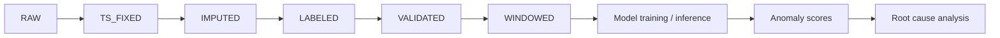

# Automated Diagnostics and Root Cause Analysis

> **DRAFT — NOT VERIFIED AGAINST THE REPOSITORY.**
> This README was drafted without access to the source code. Every item marked
> `Needs Verification` must be checked against the repository before publishing.
> The project is under active development and is not complete.

## Table of Contents

1. [Overview](#overview)
2. [Development Status](#development-status)
3. [Planned Architecture](#planned-architecture)
4. [Repository Structure](#repository-structure)
5. [Dataset and Data Pipeline](#dataset-and-data-pipeline)
6. [Machine Learning Methodology](#machine-learning-methodology)
7. [Evaluation and Results](#evaluation-and-results)
8. [Installation](#installation)
9. [Usage](#usage)
10. [Testing](#testing)
11. [Configuration](#configuration)
12. [Limitations and Future Work](#limitations-and-future-work)
13. [License and Citation](#license-and-citation)

## Overview

This is a university graduation project on sensor-based equipment monitoring.
It works with the MetroPT-3 air compressor dataset and aims at anomaly
detection and root cause analysis. The project is a work in progress; it makes
no claim of production readiness.

Terminology used in this project:

- **Anomaly detection** — flagging sensor behaviour that deviates from normal operation.
- **Fault diagnosis / root cause analysis** — identifying which signals or components explain a flagged anomaly.
- **Predictive maintenance** — using detection and diagnosis to anticipate failures before they occur.

Which of these are implemented is shown in the table below.

## Development Status

| Component | Current Status | Implemented Functionality | Remaining Work |
|---|---|---|---|
| Raw data loading | Needs Verification | Notebook `raw_data_loading` exists in `data_processing/` | Confirm behaviour and outputs |
| Timestamp fixing | Needs Verification | Notebook `time_stamp` exists | Confirm sorting and inconsistency flagging |
| Missing-value imputation | Needs Verification | Notebook `missing_values_imputation` exists | Confirm method and config |
| Failure-event labeling | Needs Verification | Notebook `data_labeling` exists | Confirm labeling policy (detection / predictive horizon) |
| Data validation | Needs Verification | Notebook `Validate data` exists | Confirm checks implemented |
| Windowing | Needs Verification | Notebook `Windowing` exists | Confirm window size, stride, leakage handling |
| Train/test split | Needs Verification | `02a_split_and_timestamp.ipynb`, `split_report.md` exist in `anomaly_detection/` | Confirm split strategy |
| Modular pipeline (`run_pipeline.py`) | Needs Verification | Refactor from notebooks was requested | Confirm it exists and runs |
| Anomaly detection model | Needs Verification | Unknown | Identify algorithm and artifacts |
| Root cause analysis | Needs Verification | Unknown | Identify implementation |
| RUL estimation | Needs Verification | Unknown | Confirm whether planned or implemented |
| Alerts and dashboard | Needs Verification | Unknown | Identify framework (Streamlit/Flask/other) |
| Tests | Needs Verification | Unknown | Confirm pytest suite |

## Planned Architecture

Only stages confirmed in the repository should remain in this diagram.



The six data stages come from the project's documented data-preparation design.
Everything from `Model training / inference` onward is `Needs Verification`.

## Repository Structure

Known from project notes (not re-verified):

```text
<repo>/
├── config.json
├── README.md
├── .gitignore
├── data_processing/
│   ├── EDA_Report
│   ├── Validate data
│   ├── Windowing
│   ├── baseline_Normal_Data
│   ├── data_labeling
│   ├── missing_values_imputation
│   ├── raw_data_loading
│   └── time_stamp
└── anomaly_detection/
    ├── 02a_split_and_timestamp.ipynb
    ├── features_config.json
    └── split_report.md
```

Possible additions (`run_pipeline.py`, tests, `requirements.txt`) must be
listed only after being confirmed. The proposed target tree (`src/autodiag/`,
`.github/`, `pyproject.toml`, ...) is a goal, not the current state.

## Dataset and Data Pipeline

- **Dataset:** MetroPT-3 air compressor dataset. Source and licence: `Needs Verification`.
- **Sensor columns, label column, timestamp format:** `Needs Verification`.
- **Stages:** RAW → TS_FIXED → IMPUTED → LABELED → VALIDATED → WINDOWED.
- **Labeling policies (as designed):** A = failure detection; B = predictive warning with a configurable horizon. Which is used: `Needs Verification`.
- **Split strategy and leakage prevention:** `Needs Verification` (see `split_report.md`).
- **Class imbalance:** `Needs Verification`.

## Machine Learning Methodology

`Needs Verification` — the algorithm, scaling, thresholds, score interpretation
and model persistence have not been checked. Do not state any of these until
confirmed in code.

## Evaluation and Results

No verified results are available. Add a table only with numbers traced to real
experiments, stating the split, model version and metric level (point, window
or event).

| Model | Split | Metric | Value | Notes |
|---|---|---|---|---|
| _TBD_ | _TBD_ | _TBD_ | _TBD_ | Regenerate from the evaluation script |

## Installation

Python version and dependency list: `Needs Verification`.

```bash
# Linux / macOS
python -m venv .venv
source .venv/bin/activate
pip install -r requirements.txt   # only if requirements.txt exists
```

```powershell
# Windows PowerShell
python -m venv .venv
.venv\Scripts\Activate.ps1
pip install -r requirements.txt   # only if requirements.txt exists
```

## Usage

`Needs Verification`. Document the real entry points (notebooks in order, or
`run_pipeline.py` if confirmed), with required inputs, outputs and output
locations. Do not describe a CLI that does not exist.

## Testing

`Needs Verification`: pytest suite, CI workflow, linting and pre-commit
configuration.

## Configuration

The root `config.json` and `anomaly_detection/features_config.json` exist
according to project notes. Document their keys after reading them, using
sanitized relative paths only.

## Limitations and Future Work

- The project is incomplete and under active development.
- Integration of the notebooks into a single verified pipeline: `Needs Verification`.
- Candidate improvements (suggestions, not verified limitations): event-level evaluation, threshold calibration, packaging, expanded tests, CI.

## License and Citation

No licence has been confirmed; the licensing decision is pending with the
project owner. No citation metadata has been confirmed.
